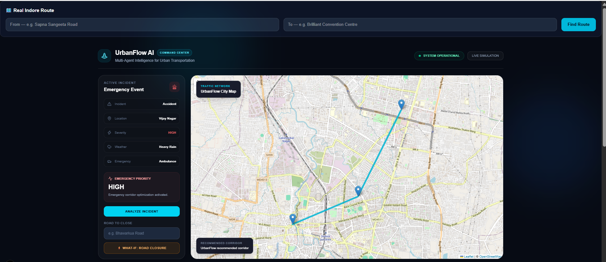
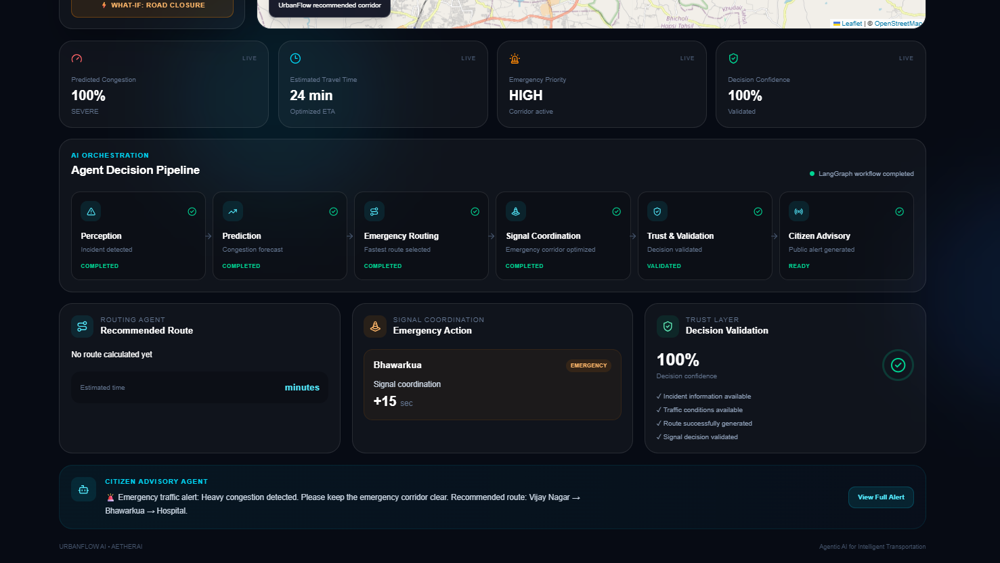
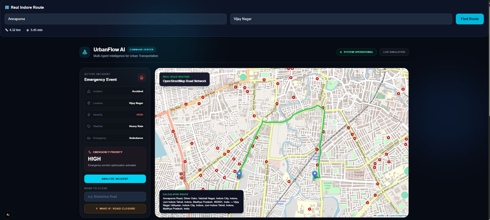
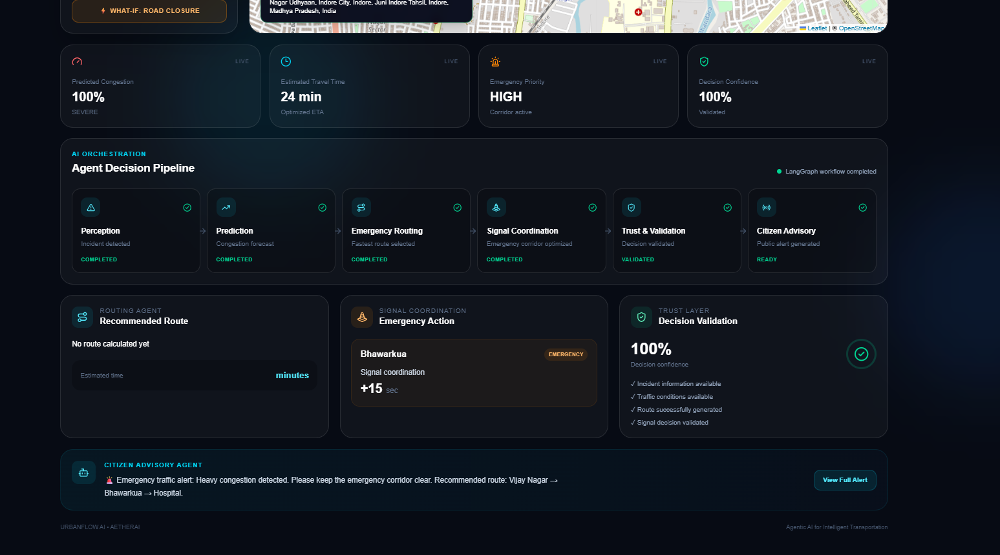

# 🚦 UrbanFlow AI
### Multi-Agent AI for Intelligent Transportation

UrbanFlow AI is an AI-driven traffic decision-support prototype designed to analyze road incidents, estimate congestion, support emergency vehicle routing, generate simulated traffic-signal recommendations, and provide citizen advisories through a coordinated multi-agent workflow.

## ✨ Features

- **Perception Agent:** Processes incident and traffic inputs.
- **Prediction Agent:** Estimates congestion conditions.
- **Emergency Routing Agent:** Calculates suitable routes using available road-network data.
- **Signal Coordination Agent:** Generates simulated emergency signal-priority recommendations.
- **Trust & Validation Agent:** Checks decisions using configured validation rules.
- **Citizen Advisory Agent:** Generates traffic-related alerts and guidance.
- **What-If Simulation:** Explores routing scenarios involving road closures.
- **Interactive Dashboard:** Displays routes, incident details, congestion indicators, and agent status.

## 📸 Screenshots

### Dashboard Overview


### Emergency Routing


### Real Road Route Calculation


### Multi-Agent Decision Pipeline


## 🛠️ Tech Stack

- Python
- FastAPI and Uvicorn
- LangGraph
- NetworkX / OSMnx, where configured
- OpenStreetMap-based geographic data and routing services, where configured
- Next.js, React, Tailwind CSS, and Leaflet, if included in the current frontend

## ⚙️ Getting Started

### 1. Clone the repository

```bash
git clone https://github.com/palakshah23/UrbanFlow-AI.git
cd UrbanFlow-AI
```

### 2. Set up the backend

```powershell
python -m venv .venv
.\.venv\Scripts\Activate.ps1
pip install -r requirements.txt
```

### 3. Run the API

```powershell
python -m uvicorn api.main:app --reload
```

Open the API documentation at:

http://127.0.0.1:8000/docs

### 4. Run the frontend

If the frontend is inside a `frontend` directory, open another terminal:

```powershell
cd frontend
npm install
npm run dev
```

Open the local URL printed in the terminal.

## 🎯 Objective

To explore how coordinated AI workflow components and road-network routing can support traffic analysis and emergency mobility decisions.

## 🔮 Future Scope

- Improved congestion prediction
- More robust route evaluation under road closures
- Explainable and uncertainty-aware decisions
- Systematic testing and performance evaluation
- Broader road-network and traffic-scenario support

## ⚠️ Disclaimer

UrbanFlow AI is an academic prototype. Its congestion estimates and signal recommendations are experimental; it does not directly control real-world traffic signals or replace official emergency services.

## 👩‍💻 Author

**Palak Shah**  
Integrated M.Tech in Artificial Intelligence  
VIT Bhopal University

[GitHub Profile](https://github.com/palakshah23) · [UrbanFlow AI Repository](https://github.com/palakshah23/UrbanFlow-AI)
